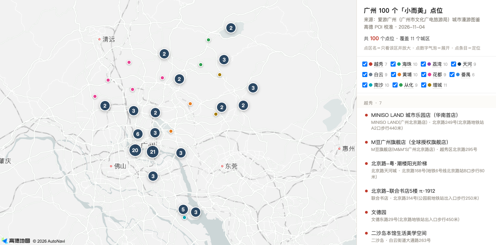

# 广州 100 个「小而美」文旅打卡点 · 交互地图

广州市文化广电旅游局（**爱游广州**）2026 年发布的城市漫游图鉴，11 个城区共 100 个打卡点，
经**高德 POI 逐点校准**后做成一张可筛选、可定位的交互地图。

🔗 **在线查看**：https://caiseyingzi.github.io/guangzhou-100-points/



---

## 这是什么

原图鉴是一份**纯图片推文**——100 个打卡点只有名字和照片，**没有地址、没有营业时间、没有简介**，
拿到手也没法直接用。

这个项目把它做成了能用的东西：

| 处理 | 说明 |
|---|---|
| 图像提取 | 14 张长图逐张 OCR，还原全部 100 个打卡点名称 |
| 照片切分 | 从 11 张城区拼图中用连通域检测切出 **100 张打卡点照片**，各区数量与清单逐一比对通过 |
| 数量校验 | 11 个城区分区计数之和 = 100，与标题一致 |
| 地理编码 | 高德 Web 服务 POI 检索，**99 / 100 命中** |
| 坐标校验 | 全部落在广州市域范围内，无越界错配 |
| 名校验 | 逐条比对原图名称与高德名称，标注异写与错字 |

---

## 怎么用

| 操作 | 效果 |
|---|---|
| **点城区名字**（右侧图例） | 只保留该区打卡点，并自动放大到看得清 |
| **点数字气泡** | 展开该聚合内的具体打卡点 |
| **点右侧列表条目** | 地图定位到该点并弹出高德名称与门牌 |
| **取消勾选城区** | 过滤掉该区 |

中心城区默认聚合显示——越秀、荔湾、海珠、天河四区共 36 个点挤在一小块，
不聚合根本看不清。

---

## 分区明细

| 城区 | 打卡点 | 城区 | 打卡点 |
|---|---|---|---|
| 越秀 | 7 | 花都 | 9 |
| 海珠 | 10 | 番禺 | **6** |
| 荔湾 | 10 | 南沙 | 10 |
| **天河** | **9** | 从化 | 9 |
| 白云 | 9 | 增城 | 11 |
| 黄埔 | 10 | **合计** | **100** |

---

## 已知问题

### ⚠️ 一处原图错字（已修正）

**「黄沙上埗集市」** —— 高德无「上埗」，实际为 **「黄沙上堓美食集市」**
（荔湾区多宝街道六二三路 484 号）。原图把「上堓」误作「上埗」。

### ✅ 100 个打卡点全部定位成功（2026-11-04 补全）

原先「湾上拾光·超级海岸线宿营地」（南沙）高德未收录，地图上只画得出 99 个。

**已通过官方地址补上：**
- 官方地址：**南沙区万顷沙镇滨湾路6号**（2026-08-20 开放）
- 高德地理编码对「滨湾路6号」只能解析到**道路级**（`113.649354, 22.569852`），门牌本身无 POI 记录，实际误差约几百米
- 位置关系已核实：距大湾区文化体育中心约 1.1 km，与「紧邻文体中心、伶仃洋畔」的公开描述一致
- 弹窗内已标注「道路级定位」，不谎称精确

**现在地图上 100 个点全部可见。**

### ✅ 已修正 5 处行政区/分店错配（2026-11-04 复校）

用高德**逆地理编码**逐点核对实际行政区，发现 4 个打卡点匹配到了别的区的同名分店，另有 1 个匹配成公交站，均已改正：

| 打卡点 | 原错误 | 已修正为 |
|---|---|---|
| MONKEY PAI 咖啡（白云） | 匹配到荔湾扬韬广场店 | **白云区生态自然学校店**（据原图照片核定为花园式户外店） |
| 蝴蝶谷溪里溪里咖啡（花都） | 匹配到番禺洛浦「蝴蝶谷」 | **花都梯面镇西坑村溪里溪里咖啡** |
| 愈欣书店（黄埔） | 匹配到海珠合生新天地店 | **愈欣书店(广州云汇店)** 黄埔科学大道 |
| 池沼 CHIZHAO LIVEHOUSE（黄埔） | 匹配到番禺新造良仓店 | **池沼科学城店** 黄埔联和街道 |
| 长岭街道黄麻村（黄埔） | 匹配到公交站 | **黄麻村驿站**（村内落点，属大致位置） |

复校后 100 个打卡点行政区**全部吻合**，0 处错配。

### ⚠️ 部分名称与高德不一致（同一实体，写法不同）

| 原图 | 高德 |
|---|---|
| 北京路-粤·潮楼阳光阶梯 | 北京路天河城（北京路 168 号） |
| 春阳台艺术文化中心 | 春阳台艺文中心（炭步镇塱头村） |
| 学山永泰里文化艺术街区 | 学山永泰里（永泰学山塘街 83 号） |
| 猫卡夫·迳下在地文化美术馆 | 猫卡夫湖景艺术餐厅（竹山路 981 号）＊业态存疑 |
| 香水公园 | 花都湖香水花园（迎宾大道） |
| 西坊大院文化旅游区 | 西坊大院文化创意园 |
| 星坊60创意园（渔人码头） | 星坊60文化创意产业园 |
| 七十二家房客拍摄基地 | 72家房客拍摄基地 |

### ⚠️ 一个打卡点暂停营业

**鳌洲码头**（海珠）—— 高德标注「暂停营业」，去之前先确认。

---

## 照片

`photos/` 下 100 张打卡点照片，命名 `dNN-MM.jpg`（NN = 城区序号 01–11，MM = 该区内序号）。

切分方法：城区长图背景是浅粉渐变，照片是彩色矩形——据此做「非背景连通域」检测，
闭运算填充照片内部的天空/白墙，取外接矩形，再按阅读顺序（先行后列）排序，
与清单顺序逐一对应。**11 个城区的检测数量与清单完全一致（7/10/10/9/9/10/9/6/10/9/11）。**

统一压到宽 560px、JPEG q82，共 2.5 MB。

---

## 移动端

已做响应式适配，三种布局：

| 视口 | 布局 |
|---|---|
| **桌面 / iPad 横屏**（>820px） | 左地图 + 右 360px 侧栏 |
| **手机竖屏**（≤820px 且高度>520px） | 上地图 47vh + 下可滚动列表；城区筛选改为单行横滑胶囊 |
| **手机横屏**（高度≤520px） | 左地图 + 右 320px 侧栏（隐藏来源说明以让出列表高度） |

细节：`viewport-fit=cover` + `env(safe-area-inset-bottom)` 避开 iPhone 底部横条；缩略图 68×51、点击区加大到 44px 以上；点列表项会自动把地图滚回视野；窗口旋转/尺寸变化时地图自动 resize 并重算聚合。

### 怎么看

`#legend` 城区筛选在手机上是**单行横滑**的，末尾有渐隐提示；标题行右侧有「清空／全选」一键切换。

---

## 数据

`data/points.json` —— 每个打卡点包含：

```json
{
  "district": "天河",
  "idx": 2,
  "name": "从前慢森林书房（火炉山店）",
  "lng": 113.xx,
  "lat": 23.xx,
  "poi_name": "高德返回的 POI 名称",
  "address": "高德返回的地址"
}
```

---

## 照片

`photos/` 下 100 张打卡点照片，命名 `dNN-MM.jpg`（NN = 城区序号 01–11，MM = 该区内序号）。

切分方法：城区长图背景是浅粉渐变，照片是彩色矩形——据此做「非背景连通域」检测，
闭运算填充照片内部的天空/白墙，取外接矩形，再按阅读顺序（先行后列）排序，
与清单顺序逐一对应。**11 个城区的检测数量与清单完全一致（7/10/10/9/9/10/9/6/10/9/11）。**

统一压到宽 560px、JPEG q82，共 2.5 MB。

---

## 移动端

已做响应式适配，三种布局：

| 视口 | 布局 |
|---|---|
| **桌面 / iPad 横屏**（>820px） | 左地图 + 右 360px 侧栏 |
| **手机竖屏**（≤820px 且高度>520px） | 上地图 47vh + 下可滚动列表；城区筛选改为单行横滑胶囊 |
| **手机横屏**（高度≤520px） | 左地图 + 右 320px 侧栏（隐藏来源说明以让出列表高度） |

细节：`viewport-fit=cover` + `env(safe-area-inset-bottom)` 避开 iPhone 底部横条；缩略图 68×51、点击区加大到 44px 以上；点列表项会自动把地图滚回视野；窗口旋转/尺寸变化时地图自动 resize 并重算聚合。

### 怎么看

`#legend` 城区筛选在手机上是**单行横滑**的，末尾有渐隐提示；标题行右侧有「清空／全选」一键切换。

---

## 数据来源与性质

- **打卡点名单**：广州市文化广电旅游局官方公众号「爱游广州」《漫游花城全新图鉴｜100个"小而美"点位》
- **坐标与地址**：高德地图开放平台 Web 服务 API 检索结果
- **整理时间**：2026-11-04

本项目为**个人整理与可视化**，非官方发布。打卡点是否开放、营业时间、门票等信息
**请以现场与商家实际为准**，本项目不承担由此产生的责任。

---

## 技术栈

单文件 HTML · 高德地图 JS API 2.0 · 原生 JS（无构建、无依赖）

- **地图聚合**：自实现的屏幕网格聚合，不依赖 AMap.MarkerCluster 插件
- **照片切分**：Python + PIL + scipy.ndimage 连通域检测

### ⚠️ 关于照片版权

打卡点照片**版权归原拍摄方 / 广州市文化广电旅游局所有**，此处仅作个人城市漫游学习与
可视化展示之用，不作商业用途。如权利人要求，可随时移除 `photos/` 目录，地图功能不受影响。
